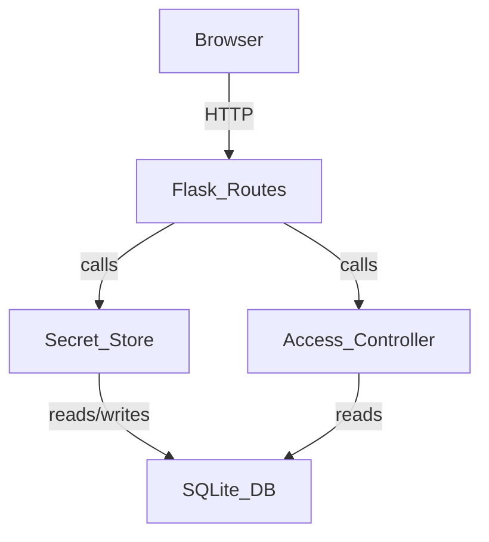

# Design Document: Time-Locked Secret

## Overview

A Flask web application that lets users store a secret (text/password) accessible only within a defined time window. Creators submit a secret with a start datetime, end datetime, and time zone. They receive a unique, unguessable link. Viewers who open that link see the secret only if the current server time falls within the window; otherwise they see an appropriate message.

The core business logic (`Secret_Store`, `Access_Controller`) is intentionally decoupled from the Flask web layer so that REST API endpoints can be added later (e.g., for an Android app) without rewriting the domain logic.

Requirement 4 (Auto Purging/Cleanup) has been removed from scope.

---

## Architecture



### Layers

1. **Web Layer** (`app/routes.py`, `app/templates/`) — Flask routes and Jinja2 templates. Handles HTTP, form parsing, and rendering. Contains no business logic.
2. **Domain Layer** (`app/secret_store.py`, `app/access_controller.py`) — Pure Python classes with no Flask imports. All business rules live here.
3. **Data Layer** (`app/db.py`) — SQLite via Python's built-in `sqlite3`. Schema creation and raw queries.

This separation means the domain layer can be imported by a future REST blueprint without modification.

---

## Components and Interfaces

### `SecretStore` (domain layer)

```python
class SecretStore:
    def create_secret(
        self,
        content: str,
        start_dt: datetime,   # naive UTC
        end_dt: datetime,     # naive UTC
    ) -> str:
        """Validates, persists, and returns the secret_id (URL token)."""

    def get_secret(self, secret_id: str) -> Secret | None:
        """Returns the Secret record or None if not found."""
```

### `AccessController` (domain layer)

```python
class AccessController:
    def check_access(
        self,
        secret: Secret,
        now_utc: datetime,
    ) -> AccessResult:
        """
        Returns AccessResult with:
          - status: 'available' | 'not_yet' | 'expired'
          - content: str | None
          - available_at: datetime | None  (for 'not_yet')
        """
```

### Flask Routes (web layer)

| Method | Path | Description |
|--------|------|-------------|
| GET | `/` | Render creation form |
| POST | `/` | Submit creation form → redirect to success page |
| GET | `/secret/<secret_id>` | View secret (delegates to `AccessController`) |

### Jinja2 Templates

- `templates/create.html` — creation form (secret text, start datetime, end datetime, timezone selector)
- `templates/success.html` — displays the generated `Secret_Link`
- `templates/view.html` — displays secret content or access-denied message

---

## Data Models

### Database Schema

```sql
CREATE TABLE secrets (
    id          TEXT PRIMARY KEY,          -- cryptographically random token (UUID4 hex, 128-bit)
    content     TEXT NOT NULL,             -- secret text, max 10,000 chars
    start_utc   TEXT NOT NULL,             -- ISO-8601 UTC datetime string
    end_utc     TEXT NOT NULL,             -- ISO-8601 UTC datetime string
    created_at  TEXT NOT NULL              -- ISO-8601 UTC datetime string
);
```

### Python Dataclass

```python
@dataclass
class Secret:
    id: str
    content: str
    start_utc: datetime
    end_utc: datetime
    created_at: datetime
```

### `AccessResult`

```python
@dataclass
class AccessResult:
    status: str          # 'available' | 'not_yet' | 'expired'
    content: str | None
    available_at: datetime | None  # populated when status == 'not_yet'
```

### Time Zone Handling

- The creation form collects a IANA time zone string (e.g., `America/New_York`).
- The web layer uses `zoneinfo.ZoneInfo` (stdlib, Python 3.9+) to convert the creator-supplied datetimes to UTC before passing them to `SecretStore`.
- All datetimes stored in SQLite are UTC ISO-8601 strings.
- `AccessController` always compares against `datetime.utcnow()` (UTC).

---

## Correctness Properties

*A property is a characteristic or behavior that should hold true across all valid executions of a system — essentially, a formal statement about what the system should do. Properties serve as the bridge between human-readable specifications and machine-verifiable correctness guarantees.*

### Property 1: Content length boundary

*For any* string of 10,000 characters or fewer, `SecretStore.create_secret` should accept it; for any string exceeding 10,000 characters, it should raise a validation error.

**Validates: Requirements 1.1**

---

### Property 2: Invalid time window rejected

*For any* pair of datetimes where `end_dt <= start_dt`, `SecretStore.create_secret` should raise a validation error and not persist any record.

**Validates: Requirements 1.4**

---

### Property 3: Empty or whitespace content rejected

*For any* string composed entirely of whitespace (including the empty string), `SecretStore.create_secret` should raise a validation error and not persist any record.

**Validates: Requirements 1.5**

---

### Property 4: Valid creation returns a sufficiently random token

*For any* valid (content, start_utc, end_utc) input, `SecretStore.create_secret` should return a hex string of at least 32 characters (≥ 128 bits of entropy), and two independent calls with the same inputs should return different tokens.

**Validates: Requirements 1.2, 5.1**

---

### Property 5: Access within window returns content

*For any* persisted secret and any UTC timestamp `t` where `start_utc <= t <= end_utc`, `AccessController.check_access` should return `status='available'` and the original secret content.

**Validates: Requirements 2.1**

---

### Property 6: Access before window returns not-yet status

*For any* persisted secret and any UTC timestamp `t` where `t < start_utc`, `AccessController.check_access` should return `status='not_yet'` with `available_at` equal to `start_utc`.

**Validates: Requirements 2.2**

---

### Property 7: Access after window returns expired status

*For any* persisted secret and any UTC timestamp `t` where `t > end_utc`, `AccessController.check_access` should return `status='expired'` and no content.

**Validates: Requirements 2.3**

---

### Property 8: Unknown secret_id returns None

*For any* string that was never stored as a secret ID, `SecretStore.get_secret` should return `None`.

**Validates: Requirements 2.4**

---

### Property 9: Timezone conversion round-trip

*For any* naive local datetime and any valid IANA timezone string, converting to UTC and then back to the original timezone should yield the original datetime (modulo DST-ambiguous times).

**Validates: Requirements 3.3**

---

## Error Handling

| Scenario | Domain response | Web response |
|---|---|---|
| Content empty / whitespace | `ValidationError` raised | Re-render form with error message |
| Content > 10,000 chars | `ValidationError` raised | Re-render form with error message |
| `end_dt <= start_dt` | `ValidationError` raised | Re-render form with error message |
| Missing timezone | `ValidationError` raised | Re-render form with error message |
| `secret_id` not found | `get_secret` returns `None` | HTTP 404 page |
| Secret not yet available | `status='not_yet'` | View page shows "available at {time}" |
| Secret expired | `status='expired'` | View page shows "this secret has expired" |
| DB error | Exception propagates | HTTP 500 generic error page |

All `ValidationError` messages are descriptive strings originating in the domain layer and surfaced verbatim in the template so the web layer adds no logic.

---

## Testing Strategy

### Dual approach

Both unit/example tests and property-based tests are required. They are complementary:
- Unit/example tests catch concrete bugs at specific inputs and verify web-layer rendering.
- Property tests verify universal correctness across the full input space.

### Property-based testing

Library: **Hypothesis** (Python).

Each property test runs a minimum of 100 iterations (Hypothesis default; increase via `@settings(max_examples=200)` for critical properties).

Each test is tagged with a comment referencing the design property:

```python
# Feature: time-locked-secret, Property 2: Invalid time window rejected
@given(end_dt=st.datetimes(), start_dt=st.datetimes())
@settings(max_examples=200)
def test_invalid_time_window_rejected(end_dt, start_dt):
    assume(end_dt <= start_dt)
    with pytest.raises(ValidationError):
        store.create_secret("some content", start_dt, end_dt)
```

Each correctness property (1–9) maps to exactly one property-based test.

### Unit / example tests

Focus on:
- Web layer rendering: creation form contains required fields (Req 6.1)
- Successful POST redirects and displays the secret link (Req 6.2)
- View page renders correct template for each access status (Req 6.3)
- Validation errors re-render the form with the error message (Req 6.4)
- Edge cases: missing timezone, missing start/end datetime fields

### Test layout

```
tests/
  test_secret_store.py       # domain: Properties 1, 2, 3, 4, 8, 9
  test_access_controller.py  # domain: Properties 5, 6, 7
  test_routes.py             # web layer: examples for Req 6.1–6.4
```
